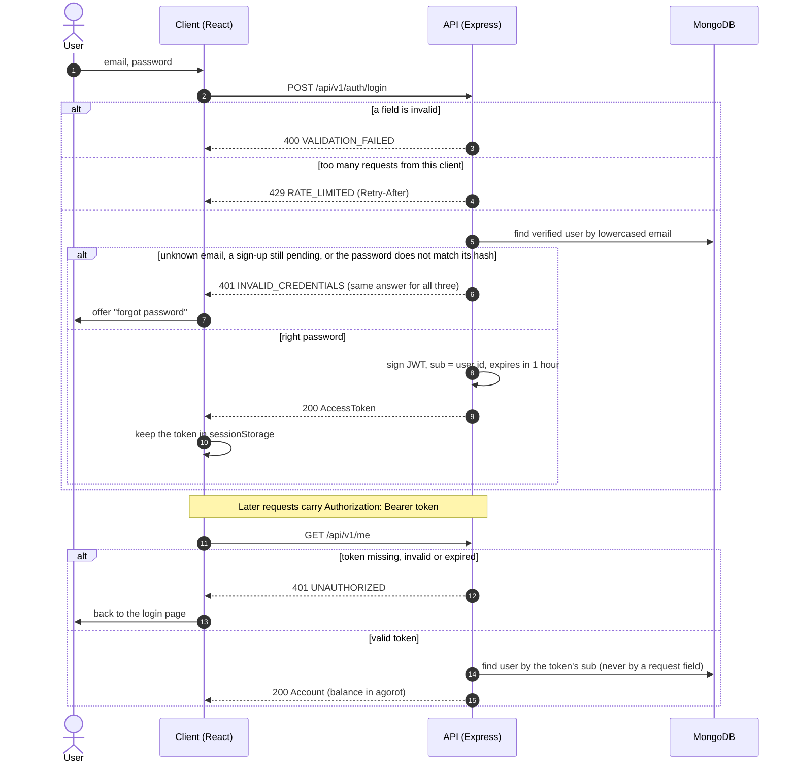

# Login

Operations `login` and `getMe` in [`api/openapi.yaml`](../../api/openapi.yaml). Token and its
storage: [ADR-0004](../decisions/0004-bearer-jwt-in-sessionstorage-client-logout.md). A pending
sign-up has no password yet, so login treats it as an unknown email
([ADR-0007](../decisions/0007-sign-up-sets-credentials-at-verification.md)); it is finished with
the passcode flow in [signup-passcode.md](signup-passcode.md). A forgotten password is reset
with [password-reset.md](password-reset.md).

