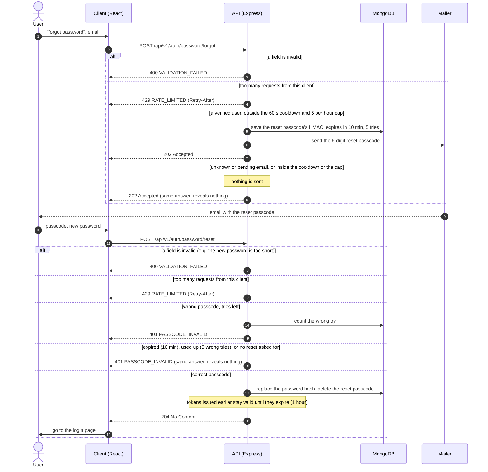

# Password reset

Operations `requestPasswordReset` and `resetPassword` in [`api/openapi.yaml`](../../api/openapi.yaml).
The reset passcode follows the sign-up passcode's rules
([ADR-0001](../decisions/0001-otp-by-email-and-passcode-rules.md)); the reset itself:
[ADR-0008](../decisions/0008-password-reset-by-emailed-passcode.md). Neither answer reveals
whether the email is registered.

