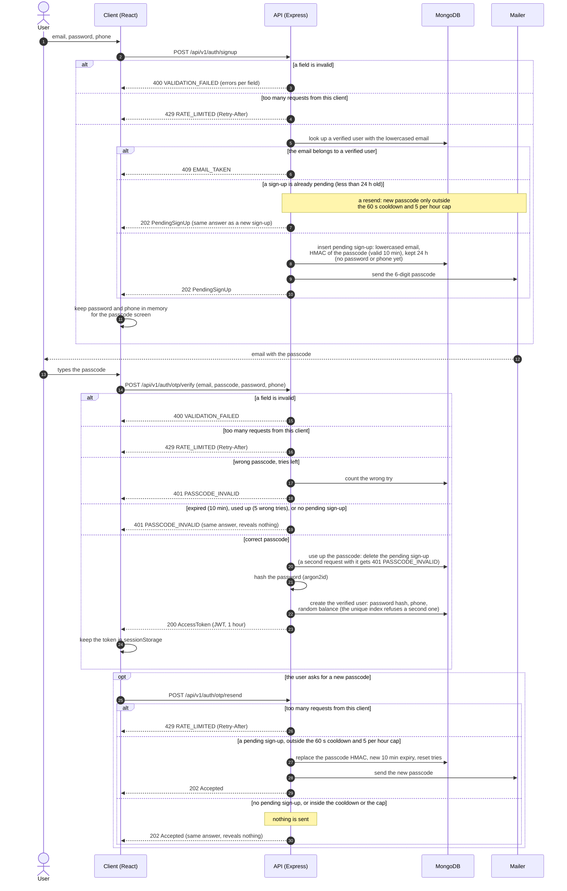

# Sign-up and passcode verification

Operations `signUp`, `verifyOtp` and `resendOtp` in [`api/openapi.yaml`](../../api/openapi.yaml).
Passcode rules: [ADR-0001](../decisions/0001-otp-by-email-and-passcode-rules.md); pending
sign-ups and why the password is saved only with the passcode:
[ADR-0007](../decisions/0007-sign-up-sets-credentials-at-verification.md); token:
[ADR-0004](../decisions/0004-bearer-jwt-in-sessionstorage-client-logout.md). Every answer
names its status and, for errors, the `code` of the problem document.

