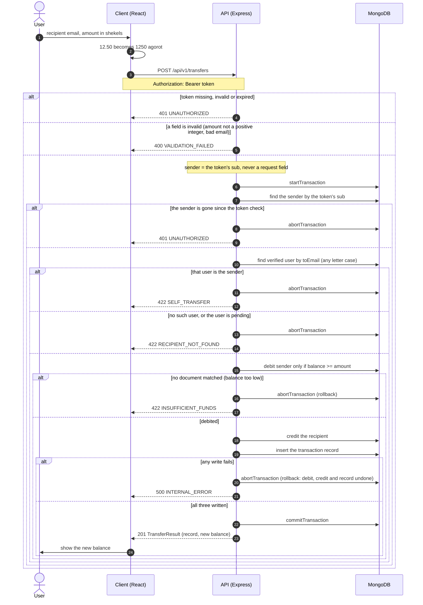

# Transfer

Operation `createTransfer` in [`api/openapi.yaml`](../../api/openapi.yaml). Money in agorot, one
record per transfer and the conditional debit:
[ADR-0003](../decisions/0003-money-in-agorot-one-record-per-transfer.md). The debit, the credit
and the record are one MongoDB transaction: either all three are committed, or the transaction
is aborted and nothing changed (rollback).

